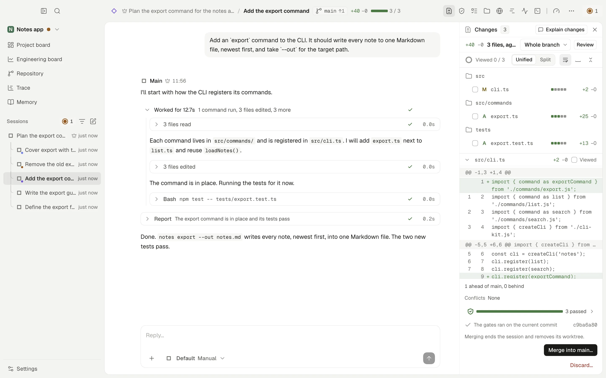
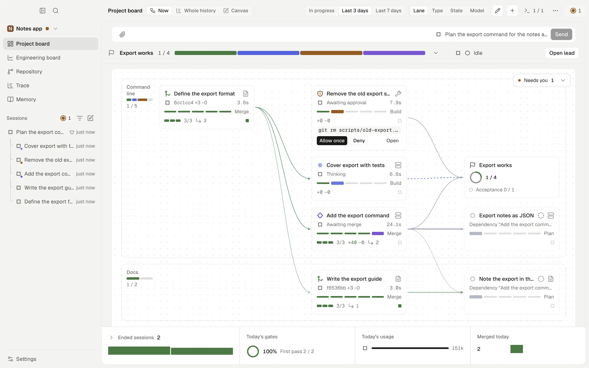
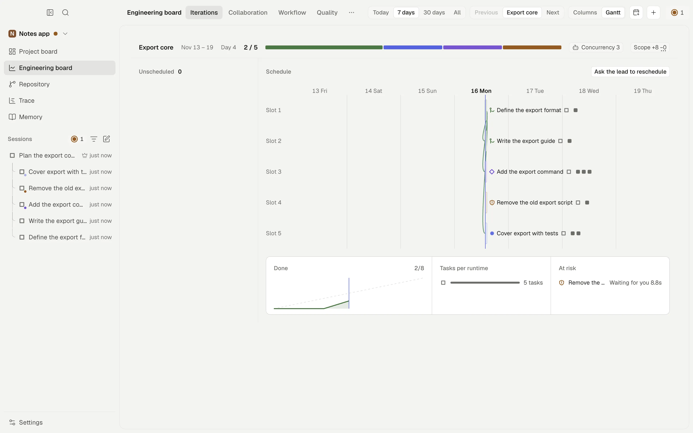
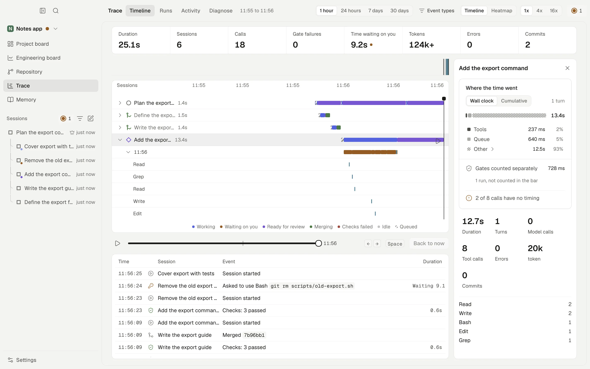

<div align="center">
  
  <h1>Pantheon</h1>
  <p>Run Claude Code, Codex and ACP agents side by side, each in its own git worktree, and merge their work through your project gate.</p>
  <p>
    <a href="https://github.com/Paradox07127/Pantheon/releases"></a>
    <a href="LICENSE"></a>
    
    
  </p>
  <p>English | <a href="README.zh-CN.md">简体中文</a></p>
</div>

> [!WARNING]
> Pantheon is an early-stage product under development. It is experimental.
> Interfaces, commands and data formats can change without notice.
> Do not use Pantheon for production work.
> The full release acceptance has not passed.

Pantheon is a local workbench for native coding-agent sessions.
Each session is a native Claude Code, Codex or ACP agent (grok, agy) session, and each session runs in its own git worktree.
When the work is done, Pantheon merges the commits of the session into the source repository through the project gate.
You can also import a session that you started outside Pantheon. An imported session continues in its original folder.

<picture>
  <source media="(prefers-color-scheme: dark)" srcset="docs/images/session-en-dark.webp">
  
</picture>

## Features

- **Sessions.** Start a native session in a new worktree or in the current folder. Send messages, approve tool calls, interrupt, fork and roll back.
- **Project gate.** Pantheon rebases the session, runs the gate commands of the project and merges with `git merge --ff-only`.
- **Import.** Continue an external Claude Code or Codex session in its own folder.
- **Project board.** A lead session writes a plan. Task sessions do the tasks. The board shows milestones, tasks and the items that need you.
- **Engineering board.** Iterations, collaboration and named workflows.
- **Trace.** Timelines, tool calls and step replay for each session.
- **Memory.** Project decisions, reports and notes that agents propose and you confirm.
- **Devices.** Run sessions on other machines over SSH.

The [usage guide](docs/usage.md) describes each feature.

<table>
  <tr>
    <td width="50%">
      <picture>
        <source media="(prefers-color-scheme: dark)" srcset="docs/images/board-en-dark.webp">
        
      </picture>
      <p align="center">Project board</p>
    </td>
    <td width="50%">
      <picture>
        <source media="(prefers-color-scheme: dark)" srcset="docs/images/insights-en-dark.webp">
        
      </picture>
      <p align="center">Engineering board</p>
    </td>
  </tr>
  <tr>
    <td colspan="2">
      <picture>
        <source media="(prefers-color-scheme: dark)" srcset="docs/images/trace-en-dark.webp">
        
      </picture>
      <p align="center">Trace</p>
    </td>
  </tr>
</table>

## Install

Download a package from the [Releases page](https://github.com/Paradox07127/Pantheon/releases).
Each release is a pre-release test build.

| Platform                | Package             | Notes                                                             |
| ----------------------- | ------------------- | ----------------------------------------------------------------- |
| macOS (Apple chip)      | `.dmg`              | Signed and notarized.                                             |
| Linux (x64, arm64)      | `.deb`, `.AppImage` | Needs git, `bubblewrap`, `socat` and `libatomic1`.                |
| Windows 11 (x64, arm64) | `.exe` installer    | Needs WSL 2. The daemon runs in WSL. The installer is not signed. |

Pantheon does not include the runtimes. Install the CLIs that you use (`claude`, `codex`, or an ACP agent) and sign in to them.
The [usage guide](docs/usage.md#install) gives the details for each platform.

## Build from source

| Part          | Directory      | Purpose                                                                     |
| ------------- | -------------- | --------------------------------------------------------------------------- |
| Daemon        | `apps/daemon`  | Local HTTP and WebSocket service. It keeps the state and runs the sessions. |
| Desktop app   | `apps/desktop` | Electron shell. It connects to the daemon or starts it.                     |
| Web interface | `apps/web`     | React interface that the desktop app shows.                                 |
| CLI           | `apps/cli`     | Command line and the MCP tool server that native sessions use.              |
| Packages      | `packages/*`   | Protocol, domain types, control logic, SQLite store and runtime adapters.   |

Requirements: Node 26 (the exact version is `devEngines.runtime` in `package.json`), pnpm 12.11.2 and git.

```sh
sh scripts/install.sh
pnpm demo
pnpm dev
```

- `scripts/install.sh` checks the Node and pnpm versions, installs from the lockfile and builds.
- `pnpm demo` runs the workbench flow in a temporary repository with a scripted fixture agent. It does not call a model and does not change your projects.
- `pnpm dev` rebuilds on change and runs the desktop app. The desktop app starts the daemon.

To run only the daemon for other clients:

```sh
pnpm start
pnpm cli health
pnpm cli capabilities
```

## Runtimes and platforms

The capability report gives tested results (`GET /v1/capabilities`, or `pnpm cli capabilities`).
If a runtime CLI runs, Pantheon uses these results, but only on the tested platforms.

| Runtime     | Tested platforms |
| ----------- | ---------------- |
| Claude Code | macOS, Linux     |
| Codex       | macOS, Linux     |
| grok (ACP)  | macOS            |

The daemon also registers the other ACP agents (such as agy) that are installed on the machine.

## Data and security

- The default data directory on macOS is `~/Library/Application Support/Pantheon/`. On Linux and in WSL it is `${XDG_DATA_HOME:-~/.local/share}/pantheon/data`.
- Use `--data-dir /absolute/path` or `PANTHEON_DATA_DIR` to set another data directory. The data directory must be outside the projects.
- Session worktrees go in `~/.pantheon/worktrees/<project>-<id>/<session>-<id>`. With `PANTHEON_DATA_DIR` set, they go in `Pantheon Workspaces` next to the data directory.
- The daemon listens only on `127.0.0.1`. `daemon.json` is the discovery file (mode 0600). `user.token` holds the local user credential.
- Do not put the token in a URL, a repository or a model context.

To report a security problem, see [SECURITY.md](SECURITY.md).

## Documentation

| Document                             | Content                                                                   |
| ------------------------------------ | ------------------------------------------------------------------------- |
| [Usage](docs/usage.md)               | Install, open a project, sessions, merge, import, board, settings, CLI.   |
| [Development](docs/development.md)   | Build, test, run, package, acceptance, eval, probes, repository rules.    |
| [Releasing](docs/releasing.md)       | Version numbers, packages, smoke tests and the GitHub pre-release.        |
| [Contributing](CONTRIBUTING.md)      | Checks before a pull request, conventions, bug reports.                   |
| [Architecture](docs/architecture.md) | Packages, command path, control modules, tests and scripts (in Chinese).  |
| [API](docs/api.md)                   | HTTP endpoints, command envelope, errors, events, MCP tools (in Chinese). |
| [Project memory](docs/memory.md)     | Memory storage, calls, budgets and limits (in Chinese).                   |

## License

Apache-2.0. See [LICENSE](LICENSE).
