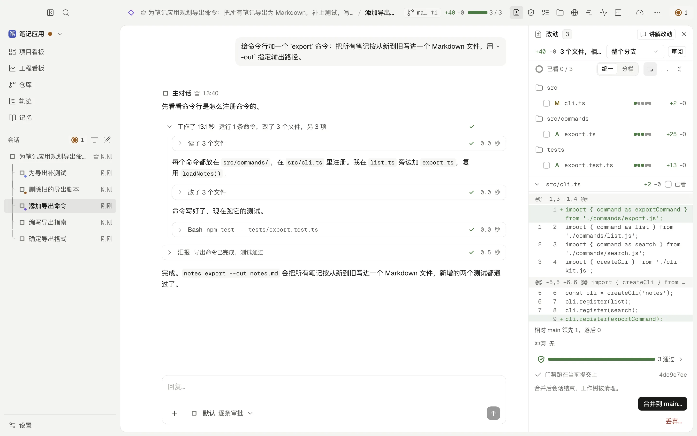
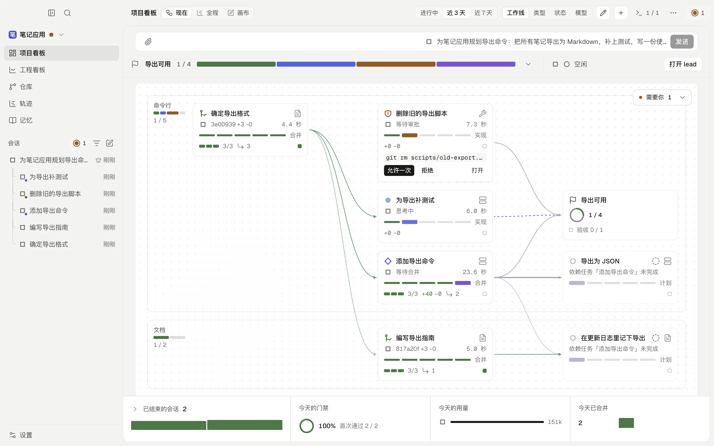
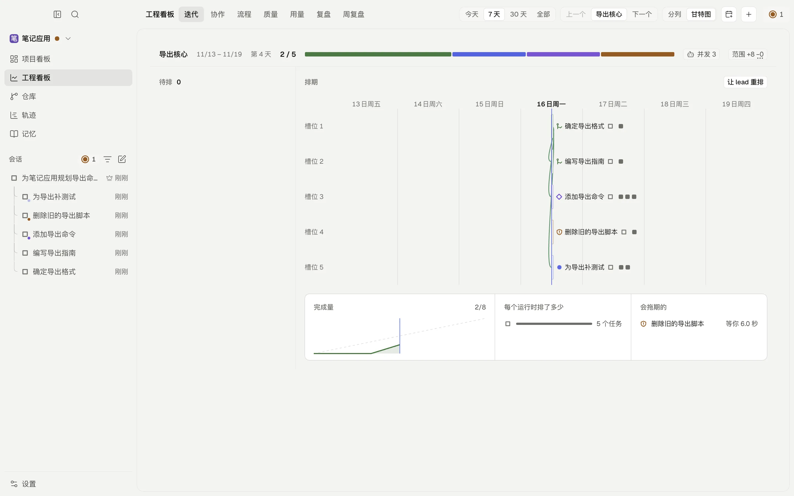
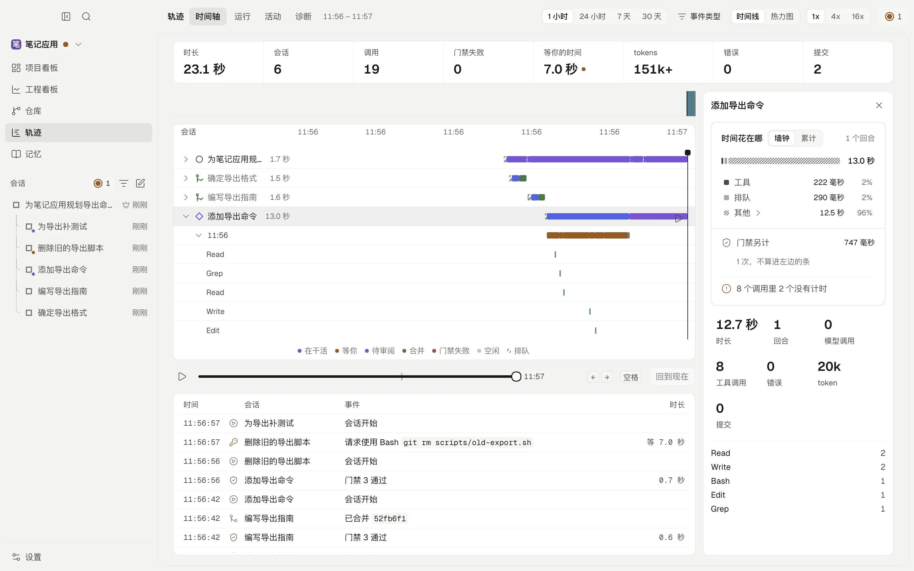

<div align="center">
  
  <h1>Pantheon</h1>
  <p>让 Claude Code、Codex 和 ACP agent 并排工作，在项目目录或各自的 git worktree 里改，改完经项目门禁落地。</p>
  <p>
    <a href="https://github.com/Paradox07127/Pantheon/releases"></a>
    <a href="LICENSE"></a>
    
    
  </p>
  <p><a href="README.md">English</a> | 简体中文</p>
</div>

> [!WARNING]
> Pantheon 是一个开发中的早期产品，仍处于实验阶段。
> 接口、命令和数据格式可能随时改变，不另行通知。
> 不要把 Pantheon 用于生产工作。
> 完整的发布验收尚未通过。

Pantheon 是一个本机运行的原生编码 agent 会话工作台。
每个会话是一个原生 Claude Code、Codex 或 ACP agent(grok、agy)会话。
新会话直接在项目目录的当前分支上改。
目录里已有会话在改、你选了起点、或 lead 和常驻 agent 派出 worker 时，会话开自己的 git worktree。
工作完成后先跑项目门禁。通过后,Pantheon 把改动提交到当前分支，或把 worktree 的提交合并回源仓库。
你也可以导入在 Pantheon 之外开始的会话。导入的会话在原目录续接。

<picture>
  <source media="(prefers-color-scheme: dark)" srcset="docs/images/session-zh-CN-dark.webp">
  
</picture>

## 功能

- **会话。** 在新 worktree 或当前目录里开原生会话。发消息、审批工具调用、打断、分叉、回滚。
- **项目门禁。** Pantheon 对会话做 rebase,跑项目的门禁命令，再用 `git merge --ff-only` 合并。
- **导入。** 在原目录续接外部的 Claude Code 或 Codex 会话。
- **项目看板。** lead 会话写计划，任务会话做任务。看板显示里程碑、任务和需要你处理的事项。
- **助理。** 每个项目的助理(Assistant)是它的默认入口：[项目看板](docs/usage.zh-CN.md#项目看板)上写的需求默认发给它。
- **工程看板。** 迭代、协作和命名工作流。
- **轨迹。** 每个会话的时间轴、工具调用和单步回放。
- **记忆。** agent 提交、由你确认的项目决定、报告和笔记。
- **设备。** 经 SSH 在别的机器上跑会话。
- **你自己的 agent。** 用个人级密钥和 `pnpm cli mcp --personal` 把[你自己的 agent](docs/usage.zh-CN.md#接入你自己的-agent)接到你的项目上。

[使用说明](docs/usage.zh-CN.md)逐项介绍这些功能。

<table>
  <tr>
    <td width="50%">
      <picture>
        <source media="(prefers-color-scheme: dark)" srcset="docs/images/board-zh-CN-dark.webp">
        
      </picture>
      <p align="center">项目看板</p>
    </td>
    <td width="50%">
      <picture>
        <source media="(prefers-color-scheme: dark)" srcset="docs/images/insights-zh-CN-dark.webp">
        
      </picture>
      <p align="center">工程看板</p>
    </td>
  </tr>
  <tr>
    <td colspan="2">
      <picture>
        <source media="(prefers-color-scheme: dark)" srcset="docs/images/trace-zh-CN-dark.webp">
        
      </picture>
      <p align="center">轨迹</p>
    </td>
  </tr>
</table>

## 安装

在 macOS 或 Linux 上，从本仓库的检出目录运行 Pantheon。这样用的是最新的 `main`。

要求:Node 26(准确版本见 `package.json` 的 `devEngines.runtime`)、pnpm 12.11.2 和 git 2.38 或更高版本。
macOS 还要装 Xcode 命令行工具。Linux 还要装 `bubblewrap` 和 `socat`。

```sh
git clone https://github.com/Paradox07127/Pantheon.git
cd Pantheon
sh scripts/install.sh
pnpm dev
```

- `scripts/install.sh` 检查 Node 和 pnpm 的版本，按锁文件安装并构建。
- `pnpm dev` 在改动后重新构建，并运行桌面端。桌面端拉起 daemon。
- 更新时，先停掉 `pnpm dev`,运行 `git pull` 和 `sh scripts/install.sh`,再运行 `pnpm dev`。

Pantheon 不自带运行时。安装你要用的 CLI(`claude`、`codex` 或 ACP agent),并登录。

### 安装包

[Releases 页](https://github.com/Paradox07127/Pantheon/releases)有安装包。每个 release 都是预发布的测试版，可能比 `main` 旧。
Windows 上用安装程序。

| 平台                   | 安装包              | 说明                                                    |
| ---------------------- | ------------------- | ------------------------------------------------------- |
| macOS(Apple 芯片)      | `.dmg`              | 已签名并公证。                                          |
| Linux(x64、arm64)      | `.deb`、`.AppImage` | 需要 git 2.38+、`bubblewrap`、`socat` 和 `libatomic1`。 |
| Windows 11(x64、arm64) | `.exe` 安装程序     | 需要 WSL 2,daemon 跑在 WSL 里。安装程序没有签名。       |

各平台的细节见[使用说明](docs/usage.zh-CN.md#安装)。

## 从源码构建

| 部分     | 目录           | 作用                                                  |
| -------- | -------------- | ----------------------------------------------------- |
| daemon   | `apps/daemon`  | 本机 HTTP 和 WebSocket 服务。保存状态，运行会话。     |
| 桌面端   | `apps/desktop` | Electron 壳。连接 daemon,或拉起 daemon。              |
| Web 界面 | `apps/web`     | 桌面端显示的 React 界面。                             |
| CLI      | `apps/cli`     | 命令行，以及原生会话使用的 MCP 工具服务。             |
| 包       | `packages/*`   | 协议、领域类型、控制逻辑、SQLite 存储和运行时适配器。 |

要求见[安装](#安装)。

```sh
pnpm demo
```

- `pnpm demo` 在临时仓库里用脚本化的 fixture agent 走一遍工作台流程。它不调用模型，不修改你的项目。

只运行供其他客户端连接的 daemon:

```sh
pnpm start
pnpm cli health
pnpm cli capabilities
```

## 运行时与平台

能力报告给出实测结论(`GET /v1/capabilities`,或 `pnpm cli capabilities`)。
运行时 CLI 能运行时,Pantheon 沿用这些结论，但只限实测过的平台。

| 运行时      | 实测平台     |
| ----------- | ------------ |
| Claude Code | macOS、Linux |
| Codex       | macOS、Linux |
| grok(ACP)   | macOS        |

daemon 也登记本机已安装的其他 ACP agent(例如 agy)。

## 数据与安全

- macOS 上默认数据目录是 `~/Library/Application Support/Pantheon/`。Linux 和 WSL 上是 `${XDG_DATA_HOME:-~/.local/share}/pantheon/data`。
- 用 `--data-dir /absolute/path` 或 `PANTHEON_DATA_DIR` 指定别的数据目录。数据目录必须在项目之外。
- 会话 worktree 放在 `~/.pantheon/worktrees/<项目>-<id>/<会话>-<id>`。设了 `PANTHEON_DATA_DIR` 时，放在数据目录旁边的 `Pantheon Workspaces` 里。
- daemon 只监听 `127.0.0.1`。`daemon.json` 是发现文件(权限 0600)。`user.token` 保存本机用户凭证。
- 不要把 token 放进 URL、仓库或模型上下文。

安全问题的报告方式见 [SECURITY.md](SECURITY.md)。

## 文档

| 文档                                  | 内容                                                 |
| ------------------------------------- | ---------------------------------------------------- |
| [使用说明](docs/usage.zh-CN.md)       | 安装、打开项目、会话、合并、导入、看板、设置、CLI。  |
| [开发说明](docs/development.zh-CN.md) | 构建、测试、运行、打包、验收、评测、探测、仓库规则。 |
| [发布](docs/releasing.zh-CN.md)       | 版本号、安装包、冒烟测试和 GitHub 预发布。           |
| [参与开发](CONTRIBUTING.zh-CN.md)     | 提 pull request 前的检查、约定、报告 bug。           |
| [架构](docs/architecture.md)          | 包划分、命令的路径、control 模块、测试和脚本。       |
| [接口](docs/api.md)                   | HTTP 端点、命令信封、错误、事件流、MCP 工具。        |
| [项目记忆](docs/memory.md)            | 记忆的存储、调用、预算与边界。                       |

## 许可

Apache-2.0。见 [LICENSE](LICENSE)。
